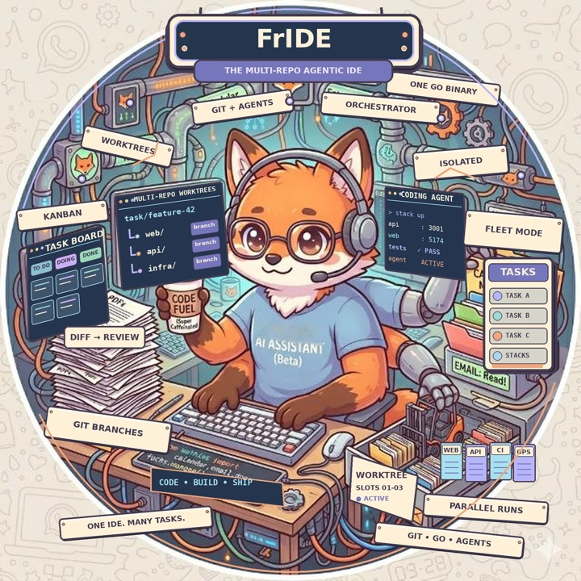

<p align="center">
  
</p>

# FrIDE

A small agentic IDE for work that spans several repositories.

One Go binary gives you:

- **task workspaces**: a folder with one git worktree per repository, all on
  the task's branch;
- **a coding agent per task** (Claude Code, Codex CLI or Antigravity CLI),
  started in that folder so it sees every repository side by side;
- **your whole dev stack per task**, started from those worktrees on ports of
  the task's own, so several tasks run at once without colliding with each
  other or with your main checkout;
- a kanban board, a file browser, terminal tabs, token usage, a decision log;
- **an orchestrator**: one agent above the others that opens workspaces from a
  sentence and keeps several of them moving while you are elsewhere.

FrIDE knows nothing about your project out of the box. **A coding agent sets
it up with you**: it asks where your repositories are and which of them make
up the app, works out how each one installs and runs, and keeps going until
your stack starts.

Why it exists: Claude Code has no multi-repo worktree flow. `claude --worktree`
makes a worktree for the one repository you are in, and `--add-dir` gives
access to a second repository but no worktree, so edits there land on its main
checkout.

## Quick start

```bash
git clone https://github.com/Icewater1337/fride && cd fride
claude          # or codex, or any coding agent
```

Then ask: **"Set up FrIDE for me."** The agent follows [SETUP.md](SETUP.md).
It builds the binary and asks which folders to scan and which repositories are
core. Then it reads your repositories, proposes the ways your stack can boot,
writes `~/.fride/config.json` and proves that it works. When it is done:

```bash
./fride serve            # http://127.0.0.1:7777
```

To update later, run `fride update`. It installs the latest release; a new
one is published every day on which `main` changed.

Requirements: Go 1.27+, git, lsof (macOS and Linux), and at least one agent
CLI. Docker only if your stack uses containers.

## Concepts

**Task.** One unit of work. It has a workspace, a branch, an agent and a port
slot. Create one in the UI (*New task*) or with
`fride task new "PROJ-42 search filters"`. Without a list of repositories, it
gets the core repositories.

**Profile.** One way to boot your stack, such as "everything from source" or
"dependencies from docker compose". You choose a profile per task and can
switch it later. Within a profile, a service runs **from source** when its
repository is checked out in the task. Otherwise it comes from a **container**
that is shared by all tasks or the task's own, or it is left out. So one
profile covers "this task changes the backend" as well as "this task only
touches the frontend".

**Slot.** Each running task holds a slot *k*, and every per-task port is the
service's base port + *k*. Slot 0, the base port itself, is left to your main
checkout. That is how ten tasks can run the same app at once.

**Rationale.** While a task runs, its agent records the decisions it takes and
the user's calls (`fride note`). When the task is done, they become a document in
the task, `docs/rationale/<task>.md`. A *ledger* repository can also collect the
documents of every task, published through plain git, including GitLab merge
requests that merge by themselves (see `ledger` in docs/CONFIG.md).

**Ideas.** A task that explores an idea rather than implementing a ticket
keeps a page about it, written by its agent as the work happens, and
*Publish idea* sends the page to the team's ideas repository (see `ideas` in
docs/CONFIG.md).

**Review.** *Review* in a task's header starts a reviewer in a tab of its
own, with the agent, model and effort you pick. It finds the merge requests
(or pull requests) of the task's branches and reviews them against each
repository's own review rules (`.pr_agent.toml`, `AGENTS.md` and the like) plus
a general rubric, then writes its findings to `REVIEW.md` in the workspace. It
only reads: nothing is pushed or commented.

**config.json.** Everything above, for your stack, in one declarative file,
written during setup and readable by a person. Reference:
[docs/CONFIG.md](docs/CONFIG.md). `fride config check` validates it.

## Your computers, as one (fleet mode)

`fride serve --fleet` links the computers you work on, over your own Tailscale
tailnet, signed in with your Google (or other) account. Only your own devices
are answered. Then:

- the board shows every computer's tasks, and their terminals and files work
  from any of them;
- a new task can run on any of your computers;
- **Continue on…** moves a task to another computer: branches, *uncommitted
  work*, decision log and the agent's conversation, which resumes there;
- **Open here** serves a stack running on another computer on this one's
  `localhost`, port for port, so the same URL and its login just work.

See [docs/FLEET.md](docs/FLEET.md).

## Run by a companion (companion mode)

`fride serve --under-fridolin` (or `FRIDE_UNDER_FRIDOLIN=1`, or
`companion.enabled` in config.json) hands fleet duties to a **companion**: a
program on the same computer that runs FrIDE as part of a larger system,
places tasks on your machines and relays news to wherever you are. FrIDE's own
fleet mode stays off; everything else, the orchestrator included, works as
always.

- `fride pair-companion` prints a one-time code the companion trades for a
  long-lived API token (`POST /api/companion/pair`, loopback only; FrIDE keeps
  only its hash).
- With the token, the companion hands over messages, follows and answers
  threads, closes tasks, asks whether a stack fits in memory, and exports and
  imports tasks, all under `/api/companion/`.
- Thread news goes to the companion's loopback webhook as JSON signed with
  HMAC-SHA256 (`X-Fride-Signature`), retried with backoff, never holding up
  the orchestrator.
- `fride task export <task> <file>` and `fride task import <file> [--as <id>]`
  carry a task as one file: branches, uncommitted work, decision log and the
  agent's conversation. They work in every mode.

Without the mode, FrIDE is exactly what it was. See
[docs/COMPANION.md](docs/COMPANION.md).

## Messages from outside (the inbox)

`fride in "<message>"` hands the orchestrator a message from anywhere: a
script, a chat bridge, an assistant relaying a voice note. It routes the
message to the task it clearly continues, starts a new task for it with the
request as the agent's first instruction, answers it, or asks back. Each
message is a **thread** that keeps what came of it, including news of the
task it went to, so the sender can read it later with `fride in status <id>`
or in the UI's Inbox, and answer with `fride in reply <id> "…"`.

The same is `POST /api/inbox` on the local API. See [docs/INBOX.md](docs/INBOX.md).

## CLI

Everything the UI does is a subcommand, so the agent inside a workspace can
drive its own stack. `[task]` is inferred from the working directory, and any
unique prefix of a task name works.

```bash
fride doctor                              # is this machine ready?
fride scan ~/work                         # what is in these repositories?
fride config check                        # validate config.json

fride task new <name> [repo[:baseref]...] [--profile p] [--agent claude|codex|antigravity] [--branch b]
fride task ls
fride task profile <task> <profile>       # applies at the next stack up
fride task service <task> <svc> <shared|task|off|default>
fride task rm <task> [--force]

fride stack up [task] [--wait] [--force]  # --wait: block until ready, exit 1 with logs if not
fride stack status [task]
fride stack logs [task] <service>
fride stack down [task]
fride stack slots

fride infra [status|up|down] [task]       # the containers behind a task
fride infra down --shared                # stop the containers all tasks share

fride note decision "..." --why "..."     # the decision log the rationale document is built from
fride rationale [task] [--narrate] [--publish]   # --publish: also push it to the ledger repo
fride idea ls | idea cat <path> | idea publish [task]   # the ideas repository

fride fleet                               # this computer and your others (fleet mode)
fride task move <task> <computer>         # continue a task on another computer
fride task export <task> <file>           # the task as one file …
fride task import <file> [--as <id>]      # … and back, in a fresh workspace

fride serve --under-fridolin              # companion mode (docs/COMPANION.md)
fride pair-companion                      # one-time code for the companion's token

fride orch say "start a task with backend and frontend from main on feat/PROJ-42"
fride orch watch <task>... [--ask]

fride in "fix the empty state of the search page" --from chat [--ref <id>] [--wait]
fride in ls | in status <id> | in reply <id> "…" | in close <id>
```

`FRIDE_HOME` moves the state folder (default `~/.fride`). Several independent
setups can coexist that way, as can a throwaway one for trying things out.

## How starting works

`stack up` resolves the task's profile against its workspace and slot, then:

1. starts the containers the profile needs: shared ones once for every task,
   the task's own through a generated compose override with its ports.
   Anything already listening on a port is adopted, not duplicated;
2. writes the task's ports and URLs into each service's local config files
   (`files`), removing keys that point at a service the task does not have;
3. starts every service from source through `fride _run`, detached. Each
   service waits for its repository's setup (dependency install) and for its
   dependencies, then becomes the configured command. That is why `stack up`
   returns at once, from the CLI as much as from the UI.

`stack up --wait` then follows the stack until every service listens and
answers its health URL. When a process exits or a setup fails, it prints the
end of that log and exits 1. The setup agent iterates on exactly that loop.

A few things worth knowing:

- **Stopping reaps by port, not just by pid.** Build tools fork the real
  server from a daemon and dev servers fork children of their own. Killing the
  launcher would leave the old build listening, and the next start would
  silently keep serving it.
- **A stack does not start into a full machine.** When the computer, or
  Docker, has less memory left than a stack needs (`memory` in config.json),
  `stack up` refuses and says what is full; `--force`, or *Start anyway* in
  the UI, overrides it.
- **A busy port is never adopted as a fresh start.** `stack up` on a port
  that something else holds refuses, rather than reporting success against the
  old process.
- **Commands run through your shell (`$SHELL -c`) with FrIDE's environment.**
  zsh reads `~/.zshenv` for every shell, so put variables tools need there
  (tokens, `JAVA_HOME`). Things initialised only in `~/.zshrc` are not seen by
  non-interactive shells.
- **Logs and pids live under `~/.fride/run/<task>/`**, outside the
  workspace, so `git status` stays clean and deleting a workspace never eats
  the logs.
- **Restarting `fride serve` ends the terminal tabs** (the PTYs belong to that
  process), but not the stack, which is detached. The agent's conversation
  survives as well: the task's *Resume* menu reopens it.

## Agents

A task picks its agent CLI when it is created. Claude Code sessions start with
`--permission-mode auto`. A task can opt into skipping permission checks
entirely; that is shown in amber. Resuming conversations and token usage read
Claude Code's own transcripts.

The orchestrator is a headless Claude Code session with **no** shell and no
write tools. It reads the workspaces (Read, Grep, Glob) and acts only through
a closed set of actions (create a task, send one line to an agent, start a
stack…) that FrIDE validates, rate-limits and logs in the chat.

## Security posture

The server binds to `127.0.0.1` only, and checks the `Host` header (DNS
rebinding) and the `Origin` header, including on the WebSocket upgrade, where
the same-origin policy does not apply. There is no authentication: any process
running as you can drive the API. Do not expose it beyond loopback. In
companion mode, `/api/companion/*` also needs the companion's bearer token and
refuses browsers (any `Origin`) and non-loopback callers.
Secret-bearing local files (`.env*`, `.npmrc`, `*.pem`, `*.key`) are withheld
from the file browser's API.

## Development

See [AGENTS.md](AGENTS.md) for the layout. `go test ./...` runs the unit tests
and an end-to-end test that builds the binary and runs a two-service stack
(needs python3).

## License

MIT, see [LICENSE](LICENSE).
