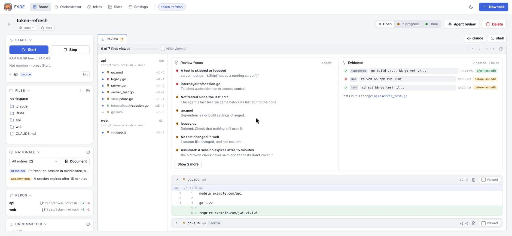
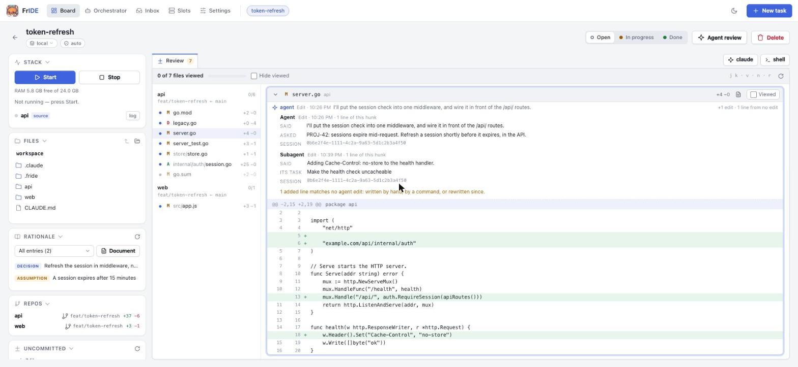

# Reviewing what the agents wrote

Most of the code in a FrIDE task is written by an agent, so the bottleneck
moves from writing to reviewing. This document proposes a review workspace
inside FrIDE. Its job is to make reading an agent's change fast. Its second job
is to make that reading trustworthy: what to look at first, what proves the
change works, and why each hunk exists.

Status: the MVP, phase 2 and phase 3 are implemented: the **Review** tab of a
task, and the **Reviews** view across tasks. Where the build differs from the
first proposal, the phase sections below say how and why.

## What FrIDE already has, and why review belongs here

A FrIDE task is a folder with one git worktree per repository. Each worktree
sits on the task's branch and records the ref it branched from (`baseRef` in
`tasks.json`). The agent runs in a PTY in that folder. FrIDE already knows four
things a code host does not:

| FrIDE knows | Where | What review gets from it |
| --- | --- | --- |
| every repo of the task, and its base | `store.Task.Repos` | one review across repos, against the right base |
| the live working tree, uncommitted and untracked files included | the worktrees | reviewing before anything is pushed |
| the agent's conversation, tool call by tool call | Claude Code transcripts (`internal/agent`) | *why* a hunk exists, and *which commands proved it* |
| the agent's own decisions, assumptions and issues | the decision log (`internal/journal`) | what the agent itself is unsure of |

A code host such as GitLab or GitHub sees only the pushed diff. A merge-request review prototype we studied (called "the
prototype" below) is a strong reader for that diff. FrIDE can be a
better reader of an *agent's* diff, because it also holds the session that
produced it. The third and fourth rows are the reason to build this inside
FrIDE rather than point a separate tool at the worktrees.

There was already a **Review** button in the task header. It starts an agent
that reviews the task's merge requests (`internal/review/skill.md`). That stays,
renamed **Agent review**. It is a reviewer working *for* you. The Review tab is
where *you* read.

## Ideas considered

The prototype and a scan of similar tools (October 2026) gave
the list below. Leverage means how much faster or safer a reviewer gets, per
unit of work.

| # | Idea | Source | Verdict |
| --- | --- | --- | --- |
| – | Diff with a file tree, per-file viewed state, "changed since you looked" | prototype, Reviewable, GitHub | **MVP**: the floor everything else stands on |
| – | Uncommitted and untracked changes included | prototype (watch mode) | **MVP**: an agent's work is mostly uncommitted |
| – | Fold mechanical noise (whitespace-only hunks, generated and lock files) | prototype | **MVP**, conservative |
| 1 | Evidence panel: commands run, with output; tests that fail on revert | Willison, Haystack | **MVP**: commands from the transcript. Revert check is phase 2 |
| 2 | The agent's session linked to the hunks it produced | Entire, Agent Trace | **MVP**: FrIDE's unique advantage |
| 3 | Review Focus: 3–7 risky spots, with the agent's own notes | Stage, Cursor | **MVP**, deterministic |
| 4 | Tour ordered by dependency layer | CodeRabbit, Devin | Phase 2 (done) |
| 5 | AI findings, verified and graded, dismissable, voted on | Claude Code Review, Devin | Phase 2 (done, feeds the Focus list) |
| 6 | Risk / merge-confidence score that weighs criticality | Greptile, Meta | Phase 3 (done) |
| 7 | Refuse oversized changes, or split them into a verified stack | Graphite, Bugbot | Phase 3 (done: warn and split) |
| 8 | Per-line AI/human provenance gutter | Agent Trace | Phase 3 (done) |
| 9 | Review comments that become agent follow-ups; Blocking/Satisfied | Reviewable, Graphite | Phase 2 (done) |
| 10 | Attention-set inbox across tasks; re-tour since last review | Gerrit, Reviewable | Phase 3 (done) |
| 11 | Tree-sitter structural diff under the noise folding | difftastic | Phase 3 (done as moved-block detection; see below) |

### What we take from the prototype, and what we do differently

Worth taking: hunk ids the model must copy verbatim, with a reconciler that
puts every hunk in exactly one group (phase 2). Two separate scales,
*significance* (reading effort, 1–5) and *criticality* (blast radius, 1–5,
with a required concrete reason) (phase 2). Noise that always says *why* it was
folded. Convention files read at the compared ref.

Done differently, because of weaknesses found in its code:

- **A viewed mark expires when the file changes.** The prototype keys viewed state by
  path alone, so a file you viewed stays "viewed" after the agent rewrites it.
  FrIDE stores a hash of the file's diff with the mark. A changed file comes
  back as *changed since viewed*, the state that matters most while an agent
  is still working.
- **"Changed since you looked" survives a reload.** The prototype overwrites its visit
  snapshot on page load. FrIDE compares against the hash stored with the
  viewed mark, which only changes when you mark the file again.
- **Merge-base, and untracked files.** Its working-tree mode diffs against
  the base tip and leaves out untracked files. FrIDE diffs against the
  merge-base and includes them, the same way the Repos panel already counts.
- **Content-addressed hunk ids.** `path#n` shifts whenever an earlier hunk
  changes. FrIDE hashes the hunk's content.
- **A new import is not noise.** The prototype folds import-only hunks, which hides a
  new dependency. FrIDE does not fold imports. A changed dependency manifest
  is a Focus item instead.
- **State lives on the server**, not in localStorage. It follows the task to
  another browser, and to fleet computers through the existing API proxy.

## MVP



A **Review** tab sits first in the task's tab bar, next to the agent and shell
tabs. Its badge counts the files not yet viewed.

```
┌ Review 7 ┬ claude ┬ shell ┐                       [Agent review] [↻]
├──────────────────────┬──────────────────────────────────────────────────┤
│ 5 of 12 viewed ▓▓▓░░ │ REVIEW FOCUS                                     │
│ [ ] hide viewed      │ ● internal/auth/session.go   touches auth code   │
│                      │ ● No test changed in api     12 source files     │
│ api  (main…HEAD)     │ ● Agent assumed: "the token TTL is 15 min"       │
│  ✓ M server.go +40-3 │ ● go.mod                     dependencies changed │
│  ● M auth/session.go │──────────────────────────────────────────────────│
│  ↻ A store/tok.go    │ EVIDENCE                         2 passed 1 failed│
│    D old/legacy.go   │ ✓ go test ./...        14:02  after last edit    │
│  ⋯ go.sum  (lockfile)│ ✗ npm run lint         13:40  before last edit ▸ │
│ web                  │──────────────────────────────────────────────────│
│  ...                 │ auth/session.go   M  +31 −4          [ ] viewed  │
│                      │ ┌ ✎ claude 14:01 "Refresh the token before it…" ┐│
│                      │ │ @@ -40,6 +40,18 @@ func Refresh(…)             ││
│                      │ │ + if exp.Sub(now) < skew {                      ││
│                      │ └ whitespace-only hunk · folded ─────────────────┘│
└──────────────────────┴──────────────────────────────────────────────────┘
 j/k file · v viewed · n next unviewed · r refresh
```

1. **Changes across all of the task's repos**, each against
   `merge-base(baseRef, HEAD)`: committed, staged, unstaged and untracked
   files, with renames detected. The file tree is grouped by repo. Each row
   shows the status, `+/−` counts and a viewed state: ✓ viewed, ↻ changed
   since viewed, ● not yet viewed.
2. **Viewed state** per file. It is stored with the hash of the file's current
   diff, and is only valid while that hash matches. "Hide viewed" leaves only
   what is left to read.
3. **Review Focus**: up to 7 items, most severe first, each linking to its
   file or hunk. The sources are all deterministic, so none of them can be
   hallucinated:
   - changes in sensitive areas, matched by path (auth, crypto, secrets,
     permissions, migrations and schema, CI and deployment files), and in
     dependency manifests;
   - risky added lines: a skipped or focused test, a disabled TLS check,
     `eval`, `TODO`/`FIXME`/`HACK`, a debug print left in;
   - deleted files;
   - a repo whose source changed while none of its tests did;
   - very large files (read them line by line);
   - files the agent edited many times (it struggled there);
   - the agent's own **assumptions** and **issues** from the decision log,
     which are its "what to watch" notes;
   - evidence gaps: no test command ran after the last edit, or the last one
     failed.
4. **Evidence**: the test, build, lint and type-check commands the agent ran
   (read from its transcripts). Each shows pass or fail, the end of its
   output, and whether it ran *after the last edit*. A green run from before
   the last edit proves nothing about the code as it is now. Also listed: the
   test files the change adds or touches.
5. **Session links on hunks**: each distinctive added line is credited to the
   latest Edit/MultiEdit/Write call of the agent whose new text contains it.
   The band over a hunk names the edits that wrote it (often more than one),
   when, the agent's words just before each edit (its stated intent), and the
   prompt it was working on. It also counts the lines no edit accounts for.
   Subagents' edits count.
   
6. **Noise folding**: whitespace-only hunks and generated, vendored or lock
   files (by name, and by `linguist-generated`/`linguist-vendored` in
   `.gitattributes`) are folded, never hidden, and each says why.
7. **Credentials stay out**: a file the file browser withholds (`.env*`,
   keys, `.npmrc`) shows its counts but not its lines.
8. **Keys**: `j`/`k` next/previous file, `v` toggles viewed, `n` jumps to the
   next unviewed file, `r` refreshes.

### Data model

Nothing new goes into the worktrees, so review never dirties `git status`.
Everything the review keeps lives in one folder per task, which export and
*Continue on…* carry whole:

```
$FRIDE_HOME/review/<slug>/
  viewed.json    { "files": { "<repo>/<path>": { "hash", "at", "hunks": [ids seen] } } }
  threads.json   [Thread]
  ai.json        AI (the last pass, and the reviewer's marks on its findings)
  revert.json    { "<repo>": RevertCheck }
  edits.jsonl    Capture, one line per agent edit, appended by the hook
```

Computed per request, not stored:

```
Changes  { repos: [RepoChanges], focus: [Focus], evidence: Evidence, traced: bool,
           threads: [Thread], ai: AI, revert: {repo: RevertCheck}, size: Size,
           risk: Risk, lastReview }
RepoChanges { repo, base, mergeBase, head, branch, files: [File], err }
File     { path, oldPath, status (A|M|D|R|T), added, deleted, binary, hash,
           noise ("" | generated | vendored | lockfile), noiseWhy, layer,
           viewed ("" | viewed | changed), hunks: [Hunk], truncated, withheld }
Hunk     { id (sha1 of path+content), header, oldStart, oldLines, newStart, newLines,
           lines: ["+…", "-…", " …"], mechanical ("" | whitespace | moved),
           moves: [{line, n, path, at}], prov ("a" | "m" | "h" | " " per line),
           seen, traces: [Trace], unattributed }
Trace    { session, time, tool, intent, prompt, sidechain, lines }
Focus    { severity (high|medium|low), title, reason, repo, path, hunk }
Evidence { commands: [Command], tests: [repo/path], lastEdit }
Command  { session, time, command, kind (test|build|lint|typecheck),
           ok, output (tail), afterLastEdit }
Thread   { id, repo, path, hunk, line, quote, blocking, satisfied, outdated,
           comments: [{at, text, sent, sendErr}] }
AI       { state (running|done|failed), started, finished, err, anchors: {repo: {head, hash}},
           groups: [{title, intent, hunks, significance, criticality, why, check}],
           findings: [{id, grade (red|yellow|gray), title, detail, repo, path, hunk,
                       quote, verdict, dismissed, vote, stale}], unverified, stale }
RevertCheck { repo, state, command, caught, exitCode, output, tests, err, anchor, stale }
Risk     { score (0-100), level (low|medium|high), reasons }
```

API, served under the existing task routes, so it works for fleet computers
through the node proxy:

```
GET  /api/tasks/<slug>/changes              the whole review
PUT  /api/tasks/<slug>/changes/viewed       {repo, path, hash, hunks, viewed}
POST /api/tasks/<slug>/changes/ai           start an AI pass (202; 409 while one runs)
PUT  /api/tasks/<slug>/changes/ai/finding   {id, dismissed?, vote?: up|down|""}
POST /api/tasks/<slug>/changes/threads      {repo, path, hunk, line, quote, text, blocking, send}
PUT  /api/tasks/<slug>/changes/threads/<id> {text?, blocking?, satisfied?, send?}
POST /api/tasks/<slug>/changes/revert       {repo}: start a revert check
POST /api/tasks/<slug>/changes/split        {repo}: write the stack branch
GET  /api/review/queue                      this computer's open tasks with something to review
```

Transcript parsing is per agent, so it lives in `internal/agent`
(`trace.go`), next to the existing transcript readers. Only Claude Code is
supported, for the reason `agent.Tailable` gives. For other agents the tab
still shows the diff, focus and viewed state, and says that session links are
unavailable. The diff, focus and viewed state live in
`internal/review` (`changes.go`, `focus.go`, `link.go`, `viewed.go`,
`build.go`), beside the reviewer skill, and the tab is `web/review.js`.

The page is never redrawn under the reader. A poll every 20 seconds keeps the
tab's count current. When the change moved on, the review offers a refresh
("2 files changed since") instead of shifting the diff mid-read.

### Limits of the MVP

- **Session links are a text match**, not recorded provenance. A line written
  through a shell (`sed`, a generator) or by hand is not linked; it is counted
  as "from no edit". A generic line the agent wrote in two places of one file
  can be credited to the wrong one of them.
- **Big diffs are capped**: 3,000 lines per file and 40,000 in total. The cap
  is stated in the UI, and the file can still be opened in full.
- Evidence is what the agent *ran*. The revert check (phase 2) is the one
  thing FrIDE runs itself, and only when asked.

## Phase 2: judgement

**AI review pass** (`ai.go`). *Run AI review* in the tab runs three headless
Claude Code turns in the workspace, the way the orchestrator thinks: read-only
tools (Read, Grep, Glob), `--permission-mode dontAsk`, the prompt on stdin, the
reply validated against a JSON schema by the CLI, and
`--no-session-persistence`, so a pass never shows up among the conversations
to resume.

1. *haiku* groups the hunks by intent, copying hunk ids verbatim. A reconciler
   drops ids it made up, keeps a hunk claimed twice in its first group, and
   puts the hunks it left out in a last group of their own, so every hunk is in
   exactly one group.
2. *opus* rates each group for significance (reading effort, 1–5) and
   criticality (blast radius, 1–5, with a concrete reason), lists what to
   check, and lists findings graded red, yellow or gray.
3. Every finding has to name its hunk and quote one of its lines exactly; one
   that does not is dropped without asking anyone. The rest go to *sonnet*,
   which has to reproduce each from the code. Only confirmed findings are kept,
   with the verifier's reason; the tab says how many were left out.

The pass is anchored to each repo's head and diff hash. Once either moves it is
marked stale, and a finding whose hunk is gone is marked on its own (hunk ids
are content, so a finding on an untouched hunk stays valid). Findings can be
dismissed and voted helpful or not; the marks are kept by finding id across
runs. Red and yellow findings that are neither stale nor dismissed, and groups
of criticality 4 or 5, join the Focus list. Neither prompts nor answers are
logged, only the model and the error.

**Tour** (`tour.go`). Each file gets a layer from its path: schema and data,
logic, interface (handlers, routes, the API), callers (UI, CLI), tests, then
docs and build files. *Tour* in the header lists the files in that order across
repos, under a heading per layer, with the same viewed state; `j`/`k` follow it.
It is a guess from naming, like the noise rules, not an import graph.

**Comments that become work** (`threads.go`). A click on a line number opens a
comment. *Comment and send to agent* types it into the task's agent as a
one-line follow-up, through the orchestrator's `Send`: the same checks for a
folder-trust question or a permission dialog apply, and a failed send is kept
on the comment, so it can be sent again. A thread is *blocking* or not; a
blocking thread that is not *satisfied* keeps the task out of Done on every
path there: the status buttons, the board, `fride task status` and the
orchestrator's `set_status`. A thread whose hunk changed stays, marked as on an
earlier version, and still blocks.

**Revert check** (`revert.go`). Per repo, the command in
`repos.<name>.test` runs in a scratch worktree at the merge-base, with the
change's test files copied in (and deleted ones removed). That is the working
tree with every non-test change reverted. Tests that fail there depend on the
change; tests that pass there do not test it, which is a high Focus item and
adds to the risk. The worktree is removed afterwards whatever happened. The
command has to install what it needs, since a fresh worktree has no
`node_modules`.

**Review state travels.** The task's review folder goes into `fride task
export` and *Continue on…*, and lands under the slug the task arrives as.

## Phase 3: scale

**Risk** (`risk.go`). A score from 0 to 100, as a sum of named parts: focus
items by severity, the highest criticality of a fresh AI pass, the size, revert
checks that caught nothing, and open blocking threads. The header chip lists the
parts, largest first, so the score always says what would bring it down.

**Size guard and split** (`split.go`). Past 400 changed lines or 25 files
(folded noise aside), the tab says so and offers *Split <repo>*. The split
writes a stack of commits from the merge-base onto a new branch,
`<branch>-stack`: by the AI pass's groups while it is fresh, by layer
otherwise, a file going whole to the group that holds most of its hunks, the
parts ordered schema first. It builds the trees in index files of its own, so
neither the task's branch, its index nor its working tree is touched. The
branch is only created once the stack's last tree is identical to the working
tree as `git add -A` sees it. A change holding a credentials file is refused
rather than committed, and an existing stack branch is never overwritten.
Whole files per commit is the known limit: a file whose hunks serve two
intents lands in one of them.

**Provenance gutter** (`provenance.go`). A PostToolUse hook (`fride hook
edit`, wired into the workspace's `.claude/settings.json` next to the
PreCompact one) records every Edit, MultiEdit, Write and NotebookEdit as it
lands, in `edits.jsonl`. Each added line gets a mark in a thin gutter: *agent*
when an agent edit wrote it as it stands, *mixed* when an agent wrote a line
like it that was changed since (same start and end around a small edit), and
*none* when no agent edit accounts for it, written by hand or by a command.
The transcripts' edits count too, so workspaces made before the hook still
get a gutter. The capture is FrIDE's own record: Claude Code prunes its
transcripts after a while, and the capture travels with export. With nothing
recorded at all there is no gutter, rather than one that calls every line
hand-written.

**Re-tour and the Reviews view** (`queue.go`). A viewed mark now keeps the
ids of the hunks on screen. When the file changes, the hunks already read fold
as *read before*, so a second look starts where the change moved. The
**Reviews** view lists every open task with something to review, on this
computer and on fleet peers through the node proxy, with whose turn it is: the
agent's while it is still changing the code, yours when files wait or a
blocking comment came back from the agent. Opening one shows only what is left.

**Moved code** (`moves.go`). The proposal was a tree-sitter structural diff.
What was built instead finds runs of at least three lines (and 20
alphanumerics, git's `--color-moved` floor) that one place of a repo lost and
another gained, whitespace aside. Moved lines are tinted and say where they
came from or went; a hunk that only moves code folds as a move. A block
re-indented in place is not a move. Tree-sitter would need a C toolchain and a
grammar per language in a binary that is otherwise self-contained; line runs
catch the common case (a function moved to another file) and miss a function
moved and edited in the middle, which shows as two moved runs around the edit.

## Effort

| Part | Estimate |
| --- | --- |
| Diff engine, viewed state, API | 1 day |
| Transcript trace (edits, commands), focus heuristics | 1 day |
| Review tab UI | 1–1.5 days |
| Tests, docs | 0.5 day |
| **MVP** | **≈ 3.5–4 days** of focused work |
| Phase 2 | ≈ 1–1.5 weeks estimated; built |
| Phase 3 | ≈ 2 weeks estimated; built |
